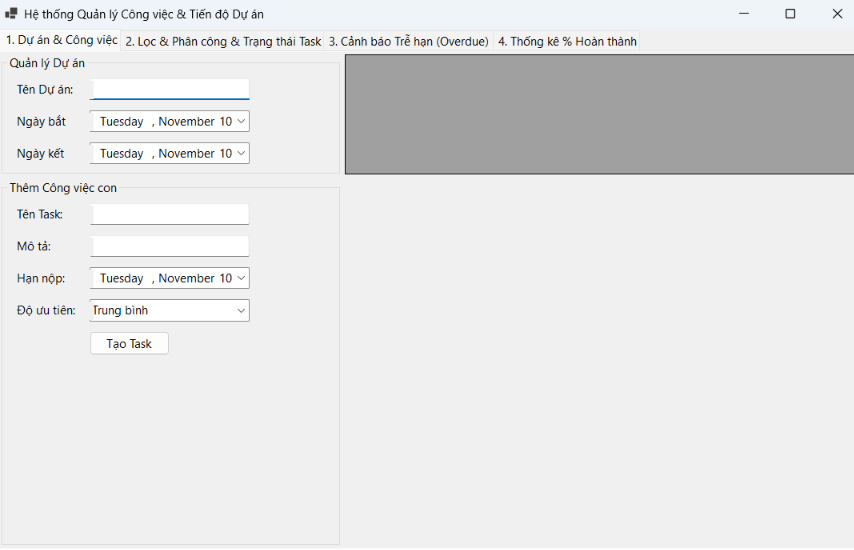

# BÀI 6.3: HỆ THỐNG QUẢN LÝ CÔNG VIỆC & TIẾN ĐỘ DỰ ÁN (PROJECT & TASK MANAGEMENT)

## MỤC 1: THÔNG TIN SINH VIÊN
* **Họ và tên sinh viên:** Đỗ Quang Toàn
* **Mã sinh viên:** 24810320100
* **Lớp / Khóa:** D19QTANM1

---

## MỤC 2: HÌNH ẢNH KẾT QUẢ CÁC MÀN HÌNH CHỨC NĂNG

### 1. Màn hình Chính / Tổng quan hệ thống
Hiển thị tổng quan giao diện ứng dụng quản lý task dạng TabControl phân chia rõ ràng các phân hệ chức năng.

### 2. Màn hình Quản lý Danh mục (CRUD - Thêm/Sửa/Xóa)
Thao tác quản lý danh sách Dự án và tạo các Công việc con (Task) thuộc từng dự án.

### 3. Màn hình Thực thi Nghiệp vụ chính
Phân công Task cho một hoặc nhiều thành viên trong nhóm và thực hiện cập nhật chuyển trạng thái công việc (To Do -> In Progress -> Done) bằng Parameterized SQL Update.

### 4. Màn hình Báo cáo - Thống kê
Thống kê tỷ lệ % hoàn thành công việc của từng thành viên trong dự án bằng truy vấn `GROUP BY` và danh sách cảnh báo công việc trễ hạn (Overdue) truy vấn qua `SqlDataReader`.

### 5. Minh họa An toàn Dữ liệu
Sử dụng Parameterized Queries (`SqlParameter`) chống tấn công SQL Injection và bọc `try-catch` kiểm soát ngoại lệ kết nối/thao tác CSDL.
